<p align="center">
  
</p>

<p align="center">
  
  
  
</p>

Ask a plain LLM for papers on a topic and it will happily invent some. This assistant only cites records it actually fetched from arXiv, OpenAlex and Semantic Scholar, so every reference in the review points to a real paper. It runs on free API tiers (Groq or Gemini) or a local model through Ollama.

The code is also a teaching walk-through. It grows from a single tool-using agent (Session 2) into a six-agent team with a human approval step (Session 3), and the [file table](#where-each-idea-lives) maps each file to the slide that explains it.

## Quick start

```bash
git clone https://github.com/JustKamlesH21/research_agent.git
cd research_agent
python -m venv agentlab
source agentlab/bin/activate          # Windows: agentlab\Scripts\activate
pip install -r requirements.txt
cp .env.example .env                  # Windows: copy .env.example .env
# put a Groq or Gemini key in .env, or point it at Ollama
python test_offline.py                # no key needed; ends with ALL OFFLINE TESTS PASSED
streamlit run app.py                  # the web UI
```

`python tools.py` checks that the live paper APIs answer.

## How the team works

<p align="center">
  
</p>

1. **Planner** turns the question into searches.
2. **Searchers** run them in parallel across the three sources.
3. **Screener** ranks the hits: 0.5 × relevance + 0.2 × recency + 0.3 × log(citations).
4. **You** approve the shortlist (in the web UI, or at the LangGraph pause).
5. **Reader** writes a validated `PaperSummary` for each paper; metadata from the API always wins over the model's version.
6. **Writer** drafts the review, and the **Critic** checks it with code (every citation must exist) and with an LLM judge.

Every team run saves `runs/<time>-<question>.md` (the review) and a `.json` with the full state, as an audit trail.

## Commands

| What | Command |
|---|---|
| Plain LLM, to watch it invent papers | `python llm.py` |
| Session 2: one agent with tools, a loop and memory | `python agent.py "Recent papers evaluating hallucination in RAG"` |
| Five validated `PaperSummary` objects | `python summary.py "your topic"` |
| Session 3: the six-agent team | `python team.py "LLM hallucination in medical QA" --since 2022` |
| Web UI | `streamlit run app.py` |
| LangGraph version with pause and resume | `pip install langgraph`, then `python graph.py "question"` |
| The tools as an MCP server | `pip install mcp`, then `python mcp_server.py` |
| Evaluate over a question set | `python eval.py test_questions.txt` → `runs/eval.csv` |

## Where each idea lives

| File | Session · slide | What it shows |
|---|---|---|
| `llm.py` | S2 · 7 | One client for every provider, picked by env vars; JSON and text helpers; retry on 429 |
| `tools.py` | S2 · 9-10, E1, E3 | arXiv, OpenAlex, citations (Semantic Scholar with an OpenAlex fallback), request pacing |
| `schemas.py` | S2 · 11 | JSON-schema tool descriptions |
| `agent.py` | S2 · 13, 20, 21 | The agent loop and its guardrails: step limit, token budget, truncation, tool allowlist, repeat-call block, errors as messages, trace |
| `prompts.py` | S2 · 14 | System prompt, with a recall-first memory rule |
| `memory.py` | S2 · 16 | Notes in Chroma, with a JSON fallback |
| `summary.py` | S2 · 17, E4 | `PaperSummary`: validate and retry |
| `state.py` | S3 · 8 | `ResearchState` |
| `team.py` | S3 · 9-15 | Planner, searchers, screener, reader, writer, critic, orchestrator, human checkpoint |
| `app.py` | S3 · 17, 21 | Streamlit UI with the shortlist approval step |
| `graph.py` | S3 · 16-17 | LangGraph with `interrupt_before=["read"]` |
| `mcp_server.py` | S3 · 18 | MCP server |
| `eval.py` | S3 · 19 | Citation validity, critic pass rate, tokens, minutes |

## If something breaks

| Symptom | Fix |
|---|---|
| The agent never calls a tool | The model lacks tool calling. Use `llama-3.3-70b-versatile` or `gemini-2.5-flash` |
| `rate limited, retrying` | Normal on free tiers; it waits and retries. Lower `SHORTLIST_K` to make fewer calls |
| Semantic Scholar HTTP 429 | It already falls back to OpenAlex |
| `chromadb` won't install | Skip it; memory falls back to `research_memory/notes.json` |

The `research_agent/` subfolder is an older copy of the same project; the files at the top level are the current ones.

## License

No license file has been added yet, so default copyright applies.

<p align="center">
  <a href="https://github.com/JustKamlesH21"></a>
</p>
